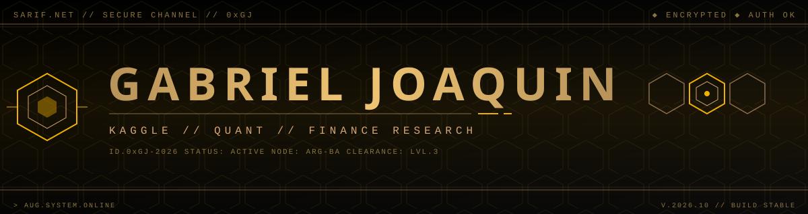

<div align="center">
  
</div>

<p align="center">
  <a href="https://www.kaggle.com/gabrieljoaquin"></a>
  <a href="https://github.com/gabrieljoaquin"></a>
  <a href="https://www.linkedin.com/in/gabrieljoaquin"></a>
  <a href="mailto:your@email.com"></a>
</p>

---

## `◢` IDENTIFICATION

```
> Machine learning and quantitative research.
> Based in Argentina.
```

---

## `◢` STACK

<p>
  
  
  
  
  
  
  
  
</p>

---

## `[DIV.01]` ◢ KAGGLE

| ID | COMPETITION | DOMAIN | METRIC | RANK |
|----|-------------|--------|--------|------|
| `K.01` | [Competition Name](https://github.com/gabrieljoaquin/kaggle-xxx) | Tabular | AUC 0.000 | 00/0000 |
| `K.02` | [Competition Name](https://github.com/gabrieljoaquin/kaggle-xxx) | CV | mAP 0.000 | 00/0000 |

---

## `[DIV.02]` ◢ QUANT

### `[02.A]` Paper Validation

| ID | PAPER | AUTHORS | YEAR | VERDICT |
|----|-------|---------|------|---------|
| `P.01` | [Paper Title](https://github.com/gabrieljoaquin/paper-xxx) | Author et al. | YYYY | Replicates / Partial / Fails |

### `[02.B]` Strategies

| ID | STRATEGY | UNIVERSE | SHARPE | MAX DD |
|----|----------|----------|--------|--------|
| `Q.01` | [Strategy Name](https://github.com/gabrieljoaquin/quant-xxx) | US Equities | 0.00 | -00.0% |

---

## `◢` METRICS

<p align="center">
  
  
</p>

---

<div align="center">
  <code>// END TRANSMISSION  //  SARIF.NET</code>
</div>
