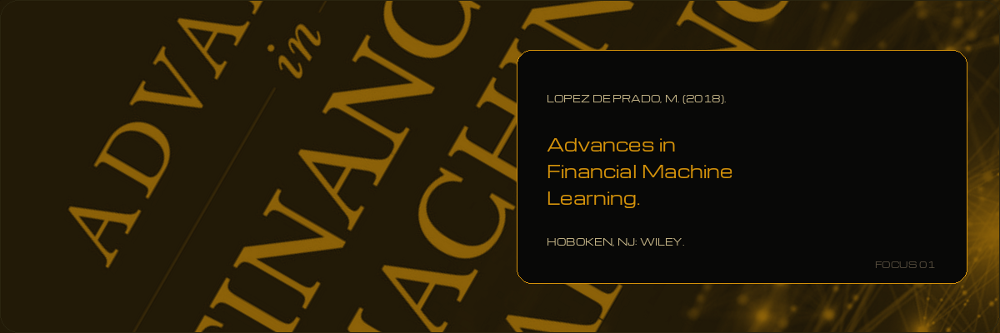
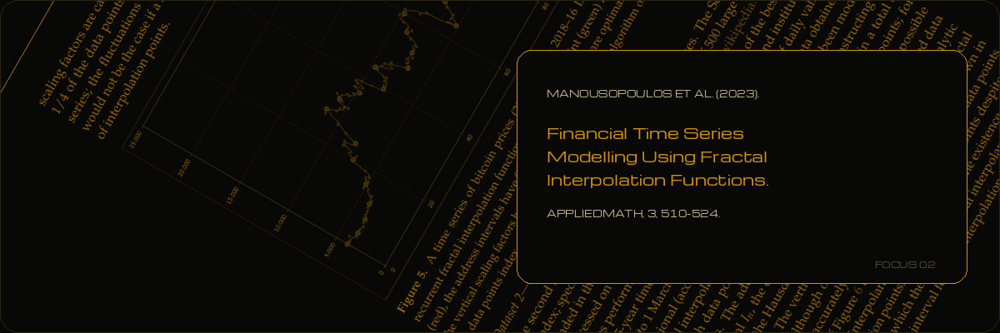
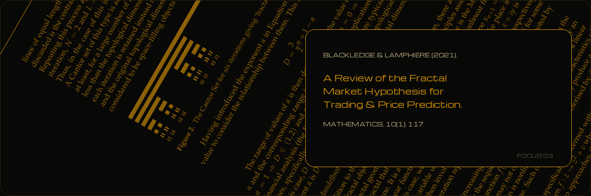
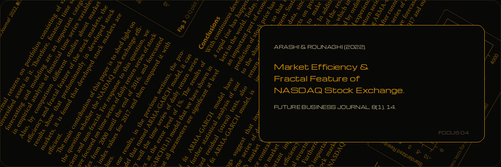

# GABRIEL JOAQUIN

`KAGGLE · QUANT RESEARCH`

  
  
  
  

---

### `[ 00 ]` IDENTIFICATION

I build models that move the P&L. 11+ years across PE, consulting, and Fortune 500s.
Buenos Aires.

---

### `[ 01 ]` CURRENT FOCUS

---

---

### `[ 02 ]` STACK

---

### `[ 03 ]` EDUCATION

**Education** — PhD(c) Finance  ·  MSc Data Science  ·  MSc Strategic & Technological Management  ·  MSc Finance  ·  CPA

**Certifications** — CMA · CSCA · PMP · PMI-ACP

---

### `[ 99 ]` METRICS

  
  

